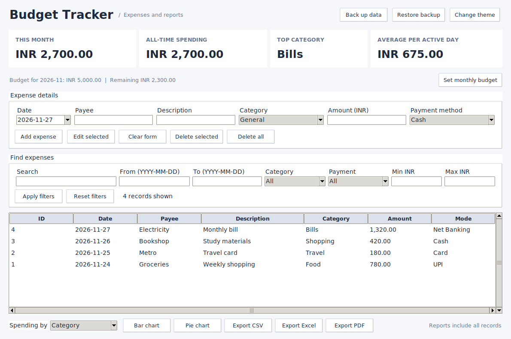
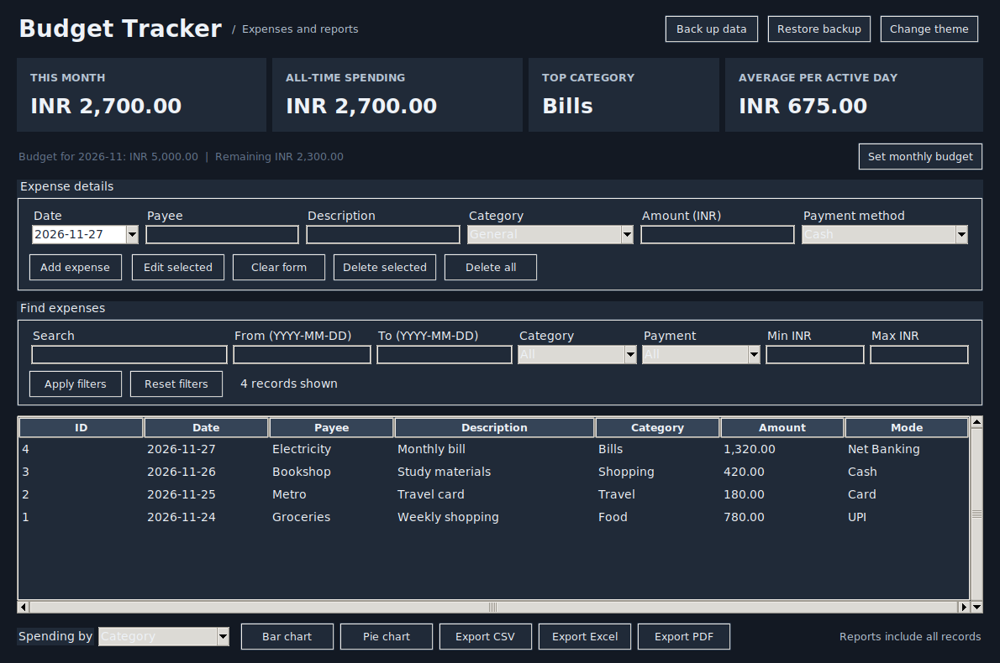
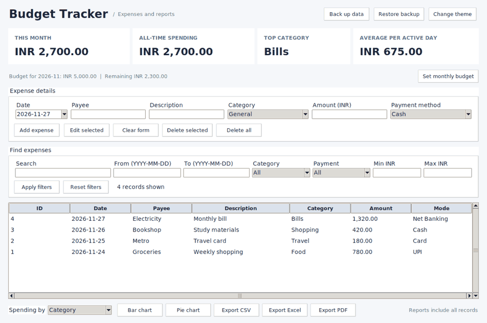

# Budget Tracker & Visualizer

A small desktop app I built during my Python internship to keep track of everyday expenses. I started with a Tkinter form and SQLite database, then added spending charts and downloadable reports. I've continued improving it with editing, search, monthly budgets, filtering and backups.

The app runs locally. You don't need an account, and your expense data isn't sent to a server.



## What it does

- **Track expenses:** Add, edit and delete entries, with a date, payee, description, category, amount and payment method.
- **Find records:** Search by text or narrow the list using a date range, category, payment method and amount range.
- **See your spending:** View this month's total, lifetime spending, top category and average spending per day with recorded transactions.
- **Set a budget:** Save a limit for the current month and see how much is left (or how far you've gone over).
- **Create charts:** Compare expenses by month, category, payee or payment method. There's also a category pie chart.
- **Export your records:** Save all entries to CSV, Excel or PDF. Exports use the complete database, even when a filter is active.
- **Back up and restore:** Save a SQLite backup file and restore it later if needed.
- **Switch themes:** Choose between light and dark mode while the app is running.

### A look at the interface

| Light | Dark |
|---|---|
|  |  |



The screenshots and GIF use sample transactions created for the demo, not personal financial data.

## Getting started

Install **Python 3.10 or newer**. On Windows, download Python from [python.org](https://www.python.org/downloads/) and check *Add Python to PATH* during setup.

Clone the repository, install its dependencies and start the app:

```bash
git clone https://github.com/dev-chirodeep/budget-tracker-visualizer.git
cd budget-tracker-visualizer
python -m pip install -r requirements.txt
python main.py
```

The app uses `expenses.db` beside `main.py` when running from source. If you already have expenses in that file, **make a backup before replacing or updating anything**. The original `ExpenseLog` database structure is preserved.

When using the packaged Windows executable, the database is stored in your user profile's `AppData\\Local\\BudgetTracker` folder instead. A new installation starts with an empty database; it does not automatically copy an older source-code database. You can move data using the in-app **Back up data** and **Restore backup** buttons.

## Using it

1. Enter a date, payee, description, category, amount and payment method, then choose **Add expense**.
2. To make a correction, select an expense and choose **Edit selected** (or double-click it). Make your changes and choose **Save changes**.
3. Use the **Find expenses** controls to search or filter the table. Choose **Reset filters** to see everything again.
4. Set a monthly budget if you want to watch your spending against a limit.
5. Use the buttons at the bottom to view charts or download a report.

Data stays on your computer. Restoring a backup replaces the current database, so save a copy of your current data first. Deleting all expenses is also permanent unless you have a backup.

## Download for Windows

A Windows build is created by GitHub Actions. Open **Actions → Test and build**, choose a successful run and download the **BudgetTracker-Windows** artifact. Extract the ZIP and open `BudgetTracker.exe`.

This is a student desktop project, not a cloud financial service. The executable is not code-signed, so Windows may show a SmartScreen warning. Inspect the source and only run builds from this repository.

## Project files

| File | Purpose |
|---|---|
| `main.py` | Tkinter interface, filters, dashboard and charts |
| `storage.py` | SQLite queries, validation, budgets and backup/restore |
| `reporting.py` | CSV, Excel and PDF export |
| `benchmark.py` | Local performance testing with made-up expense data |
| `tests/` | Automated tests for storage and reports |
| `scripts/` | GUI smoke test and screenshot/demo capture |

The GUI is kept separate from the database and export code so each part is easier to test and change.

## Tests and benchmarks

To run the unit tests:

```bash
python -m unittest discover -s tests -v
```

To measure query and export times with a temporary database:

```bash
python benchmark.py --rows 1000 --repeats 7
```

The benchmark generates **synthetic** records and saves `benchmark_results.csv` locally. These timings vary from one computer to another. They are not evidence of a percentage improvement over manual work.

For a larger scalability study (1,000, 10,000, 50,000 and 100,000 sample records), see the [measured results](benchmarks/scalability_report.md) and [raw CSV data](benchmarks/scalability_results.csv). You can reproduce those tests with `budget_tracker_scalability_benchmark.py`. The report also documents a PDF export limitation at higher record counts.

On GitHub, the **Test and build** workflow runs the tests, opens the desktop interface under a virtual display, captures the interface and creates a Windows build.

## Notes

- All data is stored in SQLite; there is no login system, cloud sync or multi-user support.
- PDF reports use a built-in font. Some Unicode characters may be replaced when exporting.
- The repository originally contained `expenses.db` and `tracker.db`. They are retained for now to avoid deleting existing data without reviewing it. New database files are excluded by `.gitignore`. Do not commit personal financial information.
- The screenshots are generated from a separate temporary test database.

## License

MIT License. See [`License.txt`](License.txt).